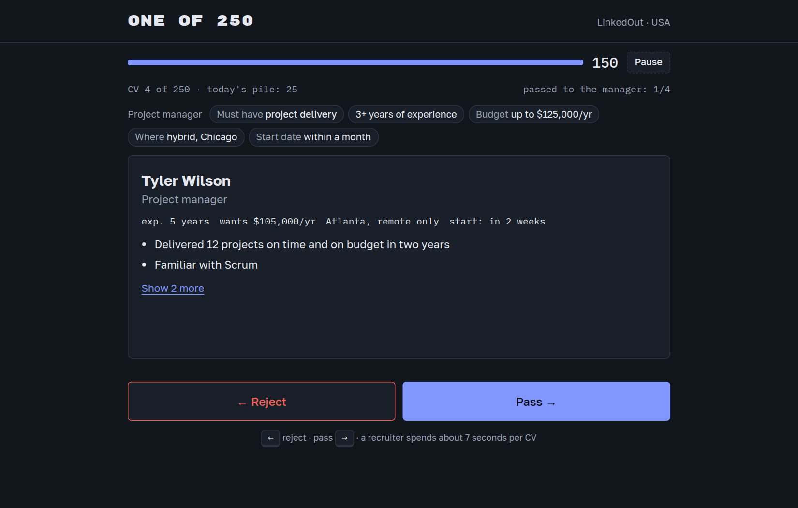

# One of 250



## English

### About the game

A browser game about job hunting, played from both sides of the desk. First you spend half a day as a recruiter and find your own CV in the pile. The next morning you are laid off, and you hunt for a job yourself, with the same CV.

**Play: https://stml89.github.io/one-of-250/**

It runs in the browser with no sign-up, on phone and desktop, in 7 languages (English, Spanish, Italian, French, Japanese, Russian, Chinese). Your character job-hunts in one of 7 countries, picked at random: Russia, USA, Spain, Italy, France, Japan or China.

### How to play

**1. The recruiter's shift.** A role has 250 CVs and you have 150 seconds. Read the brief, then reject or pass each CV with `←` / `→`, a swipe or the buttons. You see only the first two lines until you open the rest. Pass 4 good candidates to the manager. When the shift ends, the game shows you the CV you missed or misjudged: your own.

**2. Fix your CV.** You get five lines, and their order matters. Choose the lines, the headline, photo, columns, work mode and relocation, and check how it looks through a recruiter's eyes.

**3. The job search.** The goal is a job that pays at least what your last one did, before your savings run out (about 10 weeks). Each week you have 6 energy to spend:

| Action | Energy |
|---|---|
| One-click application | 0.5 |
| Application via a contact | 1 |
| Tailored application | 2 |
| Looking into a vacancy for clues | 1 |
| Interview round | 1 |
| Take-home task | 3 |
| Building a portfolio | 2 |

Not every vacancy is what it seems. Some are real, some are ghost jobs that nobody will fill, some are already promised to an internal candidate, and some are scams. Decide which is which before you spend energy. Then watch your inbox for rejections, interviews and offers, and end the week when you're done.

**4. The results.** The X-ray screen reveals what each vacancy really was and why each application succeeded or failed. If your savings ran out, you can try again a year later. The run ends with an epitaph, your points and a result card to share.

**Daily run or free play.** The daily run is the same for everyone that day and can be played once. Free play is unlimited and doesn't count. Progress is saved in your browser, so you can close the tab and come back.

### Real statistics in the game

**Where they come from.** The figures come from the organisations below. They are stored in `MARKET_STATS` and `WORLD_STATS` in [`src/countries.js`](src/countries.js), and there is no live data feed: they are updated by hand. Each country figure is recorded with its month, source and a link.

| Country | Figures | Source |
|---|---|---|
| Russia | Unemployment; CVs per vacancy (hh.index) | [Rosstat](https://rosstat.gov.ru/labour_force), [hh.ru](https://stats.hh.ru/) |
| USA | Unemployment; unemployed people per job opening; length of job search | BLS: [unemployment](https://www.bls.gov/news.release/empsit.nr0.htm), [openings](https://www.bls.gov/news.release/jolts.nr0.htm), [duration](https://www.bls.gov/news.release/empsit.t12.htm) |
| Spain, Italy, France | Unemployment; under-25 unemployment | [Eurostat](https://ec.europa.eu/eurostat/databrowser/view/une_rt_m/default/table) |
| Japan | Unemployment; jobs per applicant; permanent jobs per applicant | [Statistics Bureau of Japan](https://www.stat.go.jp/english/data/roudou/index.html), [MHLW](https://www.mhlw.go.jp/toukei/list/114-1.html) |
| China | Unemployment; youth unemployment; new graduates | [NBS](https://www.stats.gov.cn/english/PressRelease/), Ministry of Education ([via China Daily](https://govt.chinadaily.com.cn/s/202511/21/WS694a4679498e368550339281/china-to-have-12-7-million-new-college-graduates-next-year.html)) |
| Worldwide | 244 applications per vacancy (2025) | [Greenhouse](https://www.greenhouse.com/recruiting-benchmarks) |
| Worldwide | About 7 seconds per CV (7.4 s, 2018) | [TheLadders](https://www.prnewswire.com/news-releases/ladders-updates-popular-recruiter-eye-tracking-study-with-new-key-insights-on-how-job-seekers-can-improve-their-resumes-300744217.html) |

**How they are used.**

- **Shown to the player.** The country figures appear on the X-ray screen, and the two worldwide figures appear during and after the shift. Each one names its source and date and links to the source.
- **Competition.** Each country has a `press` multiplier: how many applicants a vacancy gets compared with the US. It is a design decision based on the figures, not a statistic, and the game labels it "In the game".
- **Young characters.** In Spain, Italy, France and China, a character under 25 faces extra competition, because youth unemployment there is far above the total.
- **Search length.** On a US run, the X-ray compares your search with the official median. Other countries have no such figure in the game.

**The rule.** Real figures always carry a source and date. Satirical ones, such as the fake job sites and the "market of the day", never do, so a joke can't pass for a statistic.

**Keeping them current.** Update the figures once a quarter. `tests/langcheck.js` reports any figure older than 12 months, or without a link.

### Build and publish

You need Node.js and Python 3. `dist/` is not in git, so build first:

```bash
./build.sh
```

To play your build locally, run this and open http://localhost:8765:

```bash
python3 -m http.server 8765 --directory dist/amplify
```

To run all the checks (the browser layout checks also need `npm install` once, and are skipped without it):

```bash
tests/run.sh
```

**Publish on GitHub Pages:**

1. In the repository, set **Settings → Pages → Source** to **GitHub Actions** (once).
2. Push to `main`. [`.github/workflows/pages.yml`](.github/workflows/pages.yml) builds the game and publishes `dist/amplify/index.html`.
3. Follow progress in the **Actions** tab, where **Run workflow** also starts it by hand.

### Privacy

The game has no accounts, ads or analytics, and it never sends your progress anywhere. Your run, today's result and your language are saved only in your browser (`localStorage`); clearing your site data deletes them.

Two outside services are involved: the page loads its fonts from Google Fonts, and it is hosted on GitHub Pages. Both can see ordinary request data such as your IP address.

### Disclaimer

The game is satire. Its companies, candidates and vacancies are fictional, and any resemblance to real ones is unintended. Job-site names such as LinkedOut are parodies, and the game has no connection with the real services. The real statistics are labelled with their source and date and may be out of date. Nothing here is career, legal or financial advice.

### License

© 2026 Siarhei Stamal. All rights reserved: this is not an open-source project. You may play the game, read the code for your own learning, and share links, screenshots and result cards. Copying, hosting, modifying or commercial use, including training and hiring, needs written permission. See [LICENSE](LICENSE) for the full terms and how to contact the author.

## Русский

### Об игре

Браузерная игра о поиске работы с двух сторон стола. Сначала ты полдня работаешь рекрутером и находишь в стопке собственное резюме. На следующее утро тебя сокращают, и ты ищешь работу сам, с тем же резюме.

**Играть: https://stml89.github.io/one-of-250/**

Игра идёт в браузере без регистрации, на телефоне и компьютере, на 7 языках (английский, испанский, итальянский, французский, японский, русский, китайский). Твой персонаж ищет работу в одной из 7 стран, она выбирается случайно: Россия, США, Испания, Италия, Франция, Япония или Китай.

### Как играть

**1. Смена рекрутера.** На вакансию пришло 250 резюме, а у тебя 150 секунд. Прочитай задание и отклоняй или пропускай каждое резюме клавишами `←` / `→`, свайпом или кнопками. Видны только первые две строки, пока не откроешь остальное. Нужно передать менеджеру 4 хороших кандидатов. После смены игра покажет резюме, которое ты пропустил или оценил неверно: твоё собственное.

**2. Исправь резюме.** В нём пять строк, и порядок важен. Выбери строки, заголовок, фото, колонки, формат работы и готовность к переезду и посмотри, как это выглядит глазами рекрутера.

**3. Поиск работы.** Цель: найти работу с зарплатой не ниже прошлой, пока не кончились сбережения (примерно 10 недель). Каждую неделю есть 6 единиц энергии:

| Действие | Энергия |
|---|---|
| Отклик в один клик | 0,5 |
| Отклик через знакомого | 1 |
| Отклик под вакансию | 2 |
| Изучить вакансию в поисках улик | 1 |
| Этап собеседования | 1 |
| Тестовое задание | 3 |
| Собрать портфолио | 2 |

Не все вакансии такие, какими кажутся. Есть настоящие, есть вакансии-призраки, которые никто не собирается закрывать, есть обещанные своему кандидату и есть мошеннические. Разберись, где какая, прежде чем тратить энергию. Следи за почтой: там отказы, собеседования и офферы. Когда закончишь, завершай неделю.

**4. Итоги.** Экран рентгена показывает, чем на самом деле была каждая вакансия и почему каждый отклик сработал или нет. Если сбережения кончились, можно попробовать снова через год. Забег заканчивается эпитафией, очками и карточкой результата, которой можно поделиться.

**Забег дня или свободная игра.** Забег дня один и тот же у всех в этот день, сыграть его можно один раз. Свободная игра не ограничена и в зачёт не идёт. Прогресс хранится в браузере, поэтому вкладку можно закрыть и вернуться позже.

### Реальная статистика в игре

**Откуда цифры.** Цифры взяты у организаций из таблицы ниже. Они лежат в `MARKET_STATS` и `WORLD_STATS` в [`src/countries.js`](src/countries.js). Живого потока данных нет, цифры обновляются вручную. У каждой цифры по стране записаны месяц, источник и ссылка.

| Страна | Цифры | Источник |
|---|---|---|
| Россия | Безработица; резюме на вакансию (hh.индекс) | [Росстат](https://rosstat.gov.ru/labour_force), [hh.ru](https://stats.hh.ru/) |
| США | Безработица; безработных на открытую вакансию; длительность поиска | BLS: [безработица](https://www.bls.gov/news.release/empsit.nr0.htm), [вакансии](https://www.bls.gov/news.release/jolts.nr0.htm), [длительность](https://www.bls.gov/news.release/empsit.t12.htm) |
| Испания, Италия, Франция | Безработица; безработица среди молодёжи до 25 лет | [Eurostat](https://ec.europa.eu/eurostat/databrowser/view/une_rt_m/default/table) |
| Япония | Безработица; вакансий на соискателя; постоянных вакансий на соискателя | [Статистическое бюро Японии](https://www.stat.go.jp/english/data/roudou/index.html), [MHLW](https://www.mhlw.go.jp/toukei/list/114-1.html) |
| Китай | Безработица; безработица среди молодёжи; выпускники | [NBS](https://www.stats.gov.cn/english/PressRelease/), Министерство образования ([через China Daily](https://govt.chinadaily.com.cn/s/202511/21/WS694a4679498e368550339281/china-to-have-12-7-million-new-college-graduates-next-year.html)) |
| Весь мир | 244 отклика на вакансию (2025) | [Greenhouse](https://www.greenhouse.com/recruiting-benchmarks) |
| Весь мир | Около 7 секунд на резюме (7,4 с, 2018) | [TheLadders](https://www.prnewswire.com/news-releases/ladders-updates-popular-recruiter-eye-tracking-study-with-new-key-insights-on-how-job-seekers-can-improve-their-resumes-300744217.html) |

**Как они используются.**

- **Показываются игроку.** Цифры по стране видны на экране рентгена, две мировые цифры появляются во время смены и после неё. У каждой указаны источник и дата и есть ссылка на источник.
- **Конкуренция.** У каждой страны есть множитель `press`: во сколько раз больше откликов получает вакансия по сравнению с США. Это решение дизайнера на основе цифр, а не статистика, и в игре он подписан как игровое значение.
- **Молодые персонажи.** В Испании, Италии, Франции и Китае у персонажа младше 25 лет конкуренция выше, потому что молодёжная безработица там намного выше общей.
- **Длительность поиска.** В забеге по США рентген сравнивает твой поиск с официальной медианой. Для других стран такой цифры в игре нет.

**Правило.** У реальных цифр всегда есть источник и дата. У сатирических, например у выдуманных сайтов вакансий и «рынка дня», их никогда нет, чтобы шутку нельзя было принять за статистику.

**Как поддерживать актуальность.** Цифры стоит обновлять раз в квартал. `tests/langcheck.js` сообщает о цифрах старше 12 месяцев и о цифрах без ссылки.

### Сборка и публикация

Нужны Node.js и Python 3. Папки `dist/` нет в git, поэтому сначала соберите игру:

```bash
./build.sh
```

Чтобы поиграть в свою сборку локально, запустите это и откройте http://localhost:8765:

```bash
python3 -m http.server 8765 --directory dist/amplify
```

Чтобы запустить все проверки (для проверок вёрстки в браузере один раз нужен `npm install`, без него они пропускаются):

```bash
tests/run.sh
```

**Публикация на GitHub Pages:**

1. В репозитории выберите **Settings → Pages → Source: GitHub Actions** (один раз).
2. Сделайте push в `main`. [`.github/workflows/pages.yml`](.github/workflows/pages.yml) соберёт игру и выложит `dist/amplify/index.html`.
3. Ход сборки виден во вкладке **Actions**, там же **Run workflow** запускает её вручную.

### Конфиденциальность

В игре нет аккаунтов, рекламы и аналитики, и она никуда не отправляет твой прогресс. Забег, результат дня и язык хранятся только в браузере (`localStorage`); если очистить данные сайта, они удалятся.

Участвуют два внешних сервиса: шрифты загружаются из Google Fonts, а сама страница размещена на GitHub Pages. Оба видят обычные данные запроса, например IP-адрес.

### Оговорка

Игра сатирическая. Компании, кандидаты и вакансии в ней выдуманы, любое сходство с реальными случайно. Названия сайтов вакансий, например LinkedOut, это пародии, и с настоящими сервисами игра никак не связана. Реальная статистика подписана источником и датой и может устареть. Ничто здесь не является карьерной, юридической или финансовой консультацией.

### Лицензия

© 2026 Siarhei Stamal. Все права защищены: это не проект с открытым исходным кодом. Можно играть, читать код для собственного обучения и делиться ссылками, скриншотами и карточками результата. Для копирования, размещения, изменения и коммерческого использования, в том числе в обучении и найме, нужно письменное разрешение. Полные условия и контакт автора: [LICENSE](LICENSE) (на английском).
